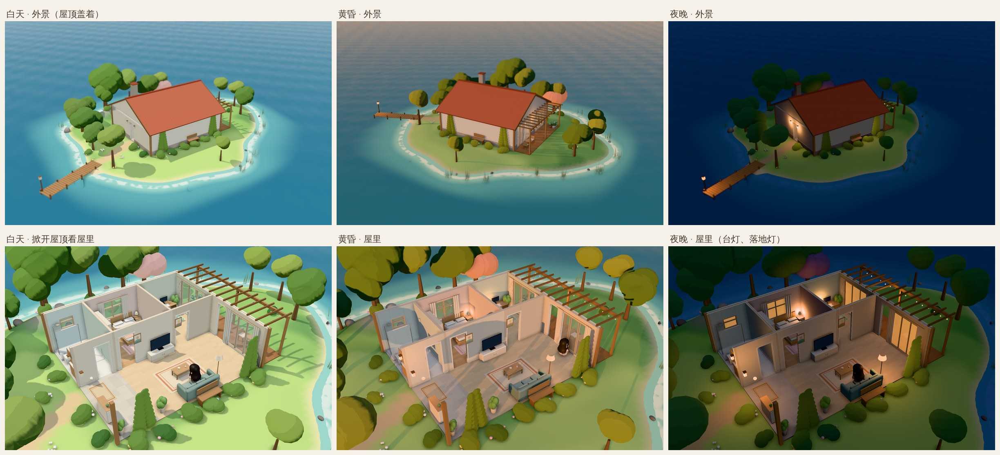

# 美术方向：湖心微缩小屋（草案 v0.1）

状态：**proposed（待客户选定）**。规则里标「proposed」的都还没确认；客户确认后改成 confirmed，并据此正式接进主场景。
整理方法参考 `.claude/skills/art-director`（定位 → 视觉语言 → 各类资产要求 → 样张 → 验收）与 `.claude/skills/3dviz-pro-max` 的风格库
（`style-tilt-shift-diorama`、`style-ghibli-painterly-pastoral`、`style-toy-miniature`、`lighting-mood-dusk-golden-hour`、`lighting-mood-night-lantern`）。
参考了这些配方的「机制」，没有照搬任何具体作品、工作室或人物。

样张：`docs/art/concept/`（总览 `overview.jpg`）。样张页面：`npm run dev` 后打开 `/concept.html`（开发用，不进打包产物）。

---

## 1. 资料与现状

| 资料 | 位置 | 用途 |
| --- | --- | --- |
| 笑笑三视图 | `assets/xiaoxiao_q_turnaround.jpg` | 身份（identity）：奶白连衣裙、黑长发、腮红、浅黄月牙 |
| 帅帅三视图（新版） | `assets/shuaishuai_q_turnaround.jpg` | 身份；模型尚未按新图重建 |
| 现有画面 | `docs/screenshots/layout2-*.png` | 现状：户型六区、软装少、整屋同一种米色墙、屋外是一块空地台 |
| 风格基线 C6 | `src/scene/lookdev.ts` | 已有：柔光环境照明、哑光 PBR、柔边阴影、环境光遮蔽 |

现状的问题（客户 2026-11-16 反馈「屋子整体比较单调」）：每个房间同色、几乎没有软装、只有一盏太阳光、屋外什么都没有。

## 2. 定位

- **看的人在做什么**：笔记本桌面上长期开着，偶尔瞄一眼「她在干嘛」，偶尔拉近看她、拖拖家具。是一个安静的陪伴画面，不是要操作的游戏。
- **想要的感受**：远离城市的湖心小岛上，一间被照顾得很好的小屋；安静、温暖、治愈。
- **注意力顺序**：她 → 她在做的事（台灯、本子、电视微光）→ 房间 → 小岛与时间、天气。
- **和「真实」的距离**：像一件精心做的桌面微缩模型——尺寸真实，看起来却像能放在手心里。

## 3. 全局视觉语言（proposed）

| 维度 | 规则 | 理由 | 样张里怎么验证 |
| --- | --- | --- | --- |
| 微缩感 | 靠**光学**做，不靠把东西做小：俯视 + 移轴（画面中间一条清晰带，上下渐糊）+ 颜色略提饱和。尺寸保持真实（门 2.1 米、人 1.2 米） | 缩小物体会显得「坏了」；移轴是微缩照片的共同特征 | `A1`（有移轴）对比 `A1b`（无移轴）：关掉后立刻变成普通航拍 |
| 形状 | 大形体圆润、可分：房子、树冠、灌木都是从上往下能一眼分开的圆块；细节低于 5 厘米就不做（除非有功能，如本子） | 俯视看的是轮廓；碎细节在这个距离只会变成噪点 | 外景三张 |
| 色彩 | 蓝（湖、天）+ 绿（草木）两大块，加**一个**高饱和暖色焦点：陶土红屋顶。粉色花树是唯一的次要点缀（呼应笑笑的腮红）。其他颜色饱和度都压低 | 一个焦点让画面有重心；多个高饱和色会互相抢 | 外景三张里屋顶始终最先被看到 |
| 明暗 | 阴影带颜色：白天偏蓝、夜里是深蓝，**不出现纯黑**；最亮处白天是云和水面高光，夜里是灯 | 手绘感的日光、灯光都是彩色的影子 | 夜景外景、屋里 |
| 材质 | 三种光感：①大面积安静的哑光（墙、布、草地、屋瓦）；②窄而亮的高光（玻璃、水面、瓷器）；③自发光（屏幕、灯罩、窗户夜光）。不用金属感 | 沿用 C6 风格基线，补上水和夜光 | 白天屋里、夜晚屋里 |
| 植被 | 树冠是几团球捏成的一整块，用 4 档明度的卡通着色，像手绘的几块色面；树干、石头、木头仍是柔和 PBR | 手绘背景的植物是「色块」不是「叶子」；和柔和的房子放一起不突兀 | 所有外景 |
| 光 | 每种时间一套：太阳方向、颜色、天光、曝光、天空、雾、水色都由一处预设驱动（`src/world/palette.ts`） | 天气、时间以后要动态切换，必须集中可控 | 白天 / 黄昏 / 夜晚 三组 |

## 4. 各类资产要求

### 4.1 屋外（自己程序生成，不用外部模型）

| 资产 | 要求（proposed） | 现在的样张实现 |
| --- | --- | --- |
| 小岛 | 绕房子的不规则圆形，房子四周至少留 3 米草地；一侧有屋后小土坡（放一棵大树打破天际线）；一条小路从入户门弯到码头。地面按「受光 / 中间 / 背光草地、小路、沙滩、岩石」几块大色面上色 | `src/world/island.ts`，约 23×19 米 |
| 湖水 | 近岸浅青绿 → 深处蓝；岸边一圈浮动白沫；斜看反射天空；远处融进地平线。不做真实反射折射 | `src/world/water.ts` |
| 天空与远山 | 天穹渐变 + 扁平手绘云（受光面、背光面两色）+ 两圈低矮远山。夜里有星星 | `src/world/sky.ts` |
| 植被 | 3 种树（圆冠、高冠、粉色花树）+ 墙根灌木 + 花丛 + 水边芦苇 + 石头。**高树离房子至少 4 米左右**；房子南面（默认视角一侧）只放矮的 | `src/world/vegetation.ts` |
| 房子外观 | 暖白灰泥墙 + 石材墙基 + 原木转角柱 + 檐口线；陶土红双坡瓦屋顶、两端山墙、烟囱；阳台上方稀疏的木花架；入户门两侧壁灯；南墙长椅和爬藤 | `src/world/exterior.ts` |
| 屋顶开合 | 拉远看全岛时盖着；拉近看屋里时抬起并淡出（`setOpen`），和现在的透明墙一起工作 | 样张里用 0 / 1 两个状态演示 |
| 码头 | 木栈道伸进湖里，尽头一盏灯（夜里是重要的暖光点） | `vegetation.ts` |

### 4.2 室内

| 资产 | 要求（proposed） |
| --- | --- |
| 墙色 | 每个房间一种墙色，都在同一个暖色家族里：客厅暖奶白、卧室淡藕粉、书房浅鼠尾草绿、卫生间浅水青、玄关米白；墙根统一白色踢脚线 |
| 软装 | 每个房间至少一件「有颜色的软东西」：地毯（带一圈呼应房间的滚边）、窗帘、绿植、挂画 |
| 灯 | 夜里每个房间至少一处暖光（约 2700K）：客厅落地灯、卧室床头灯、书房台灯、玄关壁灯、阳台串灯。灯罩本身发光，光照有衰减，形成一团团光而不是整屋均匀亮 |
| 窗 | 夜里从屋外看窗户透出暖光 |

色值都在 `src/world/palette.ts` 的 `PALETTE.rooms`。正式接入时，墙色和软装清单要进配置（`rooms.json` / `furniture.json`），不写死在代码里。

### 4.3 人物

保持现有模型（C7、C8）与三视图的身份不变；人物材质与新光照的配合（夜里台灯下的暖色、黄昏的侧光）在样张里已经成立。人物模型的精修（Hunyuan3D 重建）另行安排。

### 4.4 天空、时间、天气（只记需求，暂不做）

见 `docs/验收问题.md` C14：几种常见天气随机出现、留接口能写入天气、切换要有过渡。本方向里的预设结构（`LIGHTING`）已经为此留了位置：天气将作为第二层叠在时间预设上（云量、雾、雨雪、湿润度、光照衰减）。

## 5. 样张：证明了什么、还没证明什么

| 样张 | 证明了 | 没覆盖 |
| --- | --- | --- |
| A1 / A1b 白天外景（有 / 无移轴） | 微缩感主要来自移轴；关掉后像普通航拍 | 移轴在真机上的帧率 |
| A2 白天屋里 | 墙色 + 地毯 + 窗帘 + 绿植 + 挂画 之后屋里不再单调；掀开屋顶 + 剖开前墙能看清整屋 | 剖开时的自动判断（样张里是手动隐藏南、西两面墙） |
| A3 黄昏外景、A7 黄昏屋里 | 低太阳的长影子描出地形和家具；暖光不显得像套了滤镜 | 白天 → 黄昏 → 夜的连续过渡 |
| A4 夜晚外景、A5 夜晚屋里 | 一团团暖光组织画面；最暗处是深蓝不是黑 | 月光在水面上的倒影（暂时关掉了，见第 7 节） |
| A6 低角度外景 | 远山、湖面一直延伸到地平线 | 相机目前最大俯仰 70°，这个角度刚好在边界 |

**判定层次**：上表都是我的画面观察（无显卡软件渲染）；**没有**真机帧率实测，**没有**客户认可。

## 6. 性能（GTX 1650 笔记本，proposed 预算）

样张整景约 **38 万三角面**（原技术方案预算 15 万，见 `docs/技术方案要点.md` §6）。主要来自地形网格和树冠细分，都还有很大压缩余地。建议新预算：

| 项 | 建议 | 手段 |
| --- | --- | --- |
| 三角面 | ≤ 40 万 | 地形网格按远近降低密度；树冠细分从 2 级降到 1 级 |
| 实时光源 | 夜里 ≤ 8 盏点光源，都不投影 | 只有太阳投影 |
| 后期 | 环境光遮蔽 + 移轴，低帧率时先关环境光遮蔽、再关移轴 | 沿用现有自动降级 |
| 帧率 | 默认画质 ≥ 30 fps | 需要在客户真机上测 |

## 7. 已知问题与待定

需要客户决定的：

1. **方向本身**：这一套「湖心微缩小屋」可以吗？要更写实一些、还是更像手绘？
2. **移轴效果**：要不要？它让画面像微缩模型，但会让画面上下边缘发糊（拉近看屋里时我建议减弱或关掉）。
3. **南面外墙没有窗**：客厅南墙（沙发背后）是整面墙，从默认视角看外观有点空。样张里用长椅和爬藤补了一下。要不要在这面墙开窗？（会改 `rooms.json`）
4. **相机范围**：要看到整个岛，相机最远距离要从 16 米放到约 40 米；看远山和天空要允许更低的俯仰角。
5. **挡视线的树**：高树离房子已经拉开；正式接入时建议树也像墙一样「挡住她就变透明」，这样树可以种得更密。

技术上还没做完的：

- 月光倒影：水面法线扰动会把它散成一大团，移轴后像水上飘着一朵云，暂时关掉；以后做成一条竖向的光带。
- 风：树冠、芦苇、草的摆动（样张是静帧）。
- 屋顶开合与透明墙、外墙贴面、内墙漆的联动（样张里是手动的）。

## 8. 确定方向之后

1. 把 `src/world/` 正式接进主场景：屋顶随缩放开合、外墙贴面和内墙漆跟着透明墙一起淡出、相机范围放大。
2. 墙色、软装、灯光进配置。
3. 时间随本机时钟变化（白天 / 黄昏 / 夜晚之间平滑过渡）。
4. 天气（C14）。
5. 按需要用 Hunyuan3D 生成重点软装和植被单件（需要大显存 GPU），替换程序生成的版本；风格以本文件为准。
